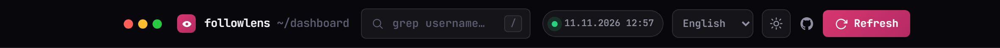

<div align="center">

# FollowLens

**Self-hosted Instagram follower analytics.** Every scan is a snapshot; FollowLens diffs them and tells you exactly who arrived, who left, and who never followed back — on your own machine, without a password.

[](https://github.com/noutrexx/follow-lens/actions/workflows/ci.yml)
[](https://github.com/noutrexx/follow-lens/actions/workflows/codeql.yml)
[](LICENSE)


</div>

---

## Overview

FollowLens captures timestamped snapshots of an account's followers and following lists, compares each run with the one before it, and presents the result as a diff: additions, removals, one-way follows and cross-account overlap.

It runs entirely on your machine. Authentication uses a session cookie you copy from your own browser, so no password is ever typed into the app, and no data is uploaded anywhere.

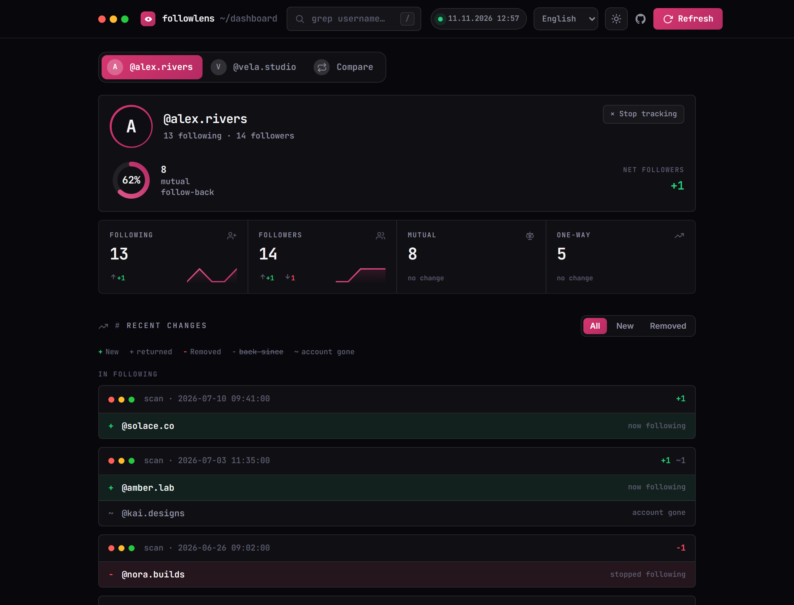

## Features

| | |
| --- | --- |
| **Scans read as diffs** | Each scan is a pane with a `+N -N` tally and one row per account, signed and labelled with what actually happened. |
| **Separates noise from real activity** | A removal only counts as an unfollow once it survives, and an addition only counts as new if the account was never seen leaving. Accounts that vanish from both lists, come back, or are handed back by a later scan are marked as such instead. |
| **Counters navigate** | Following and followers jump to their lists; mutual and one-way jump to reciprocity. Collapsed lists open on the way. |
| **Change history** | Every run is a timestamped snapshot, so any two runs remain comparable. |
| **Reciprocity** | Accounts you follow that never followed back, and the reverse. |
| **Account comparison** | Shared followers and shared following between any two tracked accounts. |
| **Search and filters** | Match any username in the active account; filter the feed to new or removed. |
| **Manage accounts from the dashboard** | Type a username that is not tracked yet into the search box and press Enter: it is added to `config.json` and read straight away, on its own. Stop tracking it from its profile tile; its history is kept. |
| **Eight languages** | English, Türkçe, 中文, Español, Deutsch, Français, Русский and 日本語 across the dashboard and the landing page. Switches without a reload and remembers the choice. |
| **Themes** | Dark by default. The header toggle switches to light and remembers the choice. |
| **Keyboard** | `/` search · `R` rescan · `T` theme · `Esc` clear. |
| **Accessibility** | Visible focus rings, keyboard-operable counters, and animations that stop when the OS asks for reduced motion. |
| **Export** | Download any account's data as JSON. |

## Screenshots

> Every image below is rendered from a generated demo dataset. No real account appears anywhere in this repository.

### Change history

One pane per scan: window lights, timestamp, tally, then the accounts that moved.

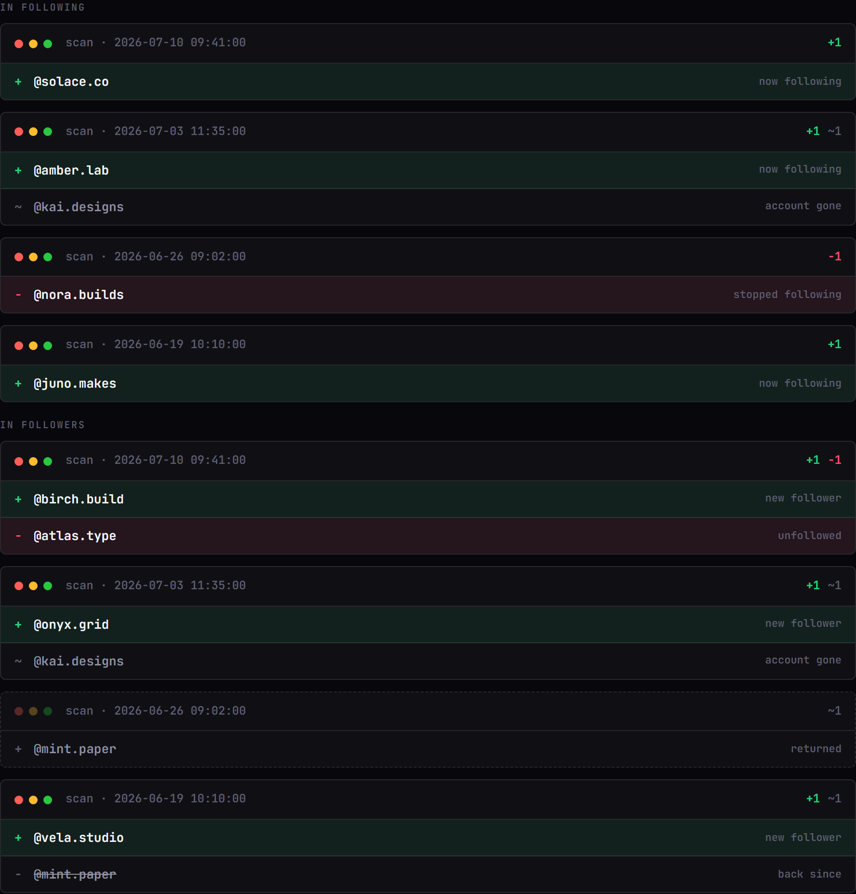

### Reciprocity

Who you follow that never followed back, and the other way round.

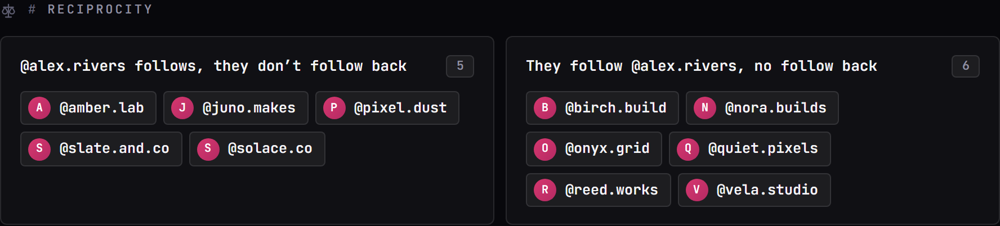

### Account comparison

Shared followers and shared following between two tracked accounts.

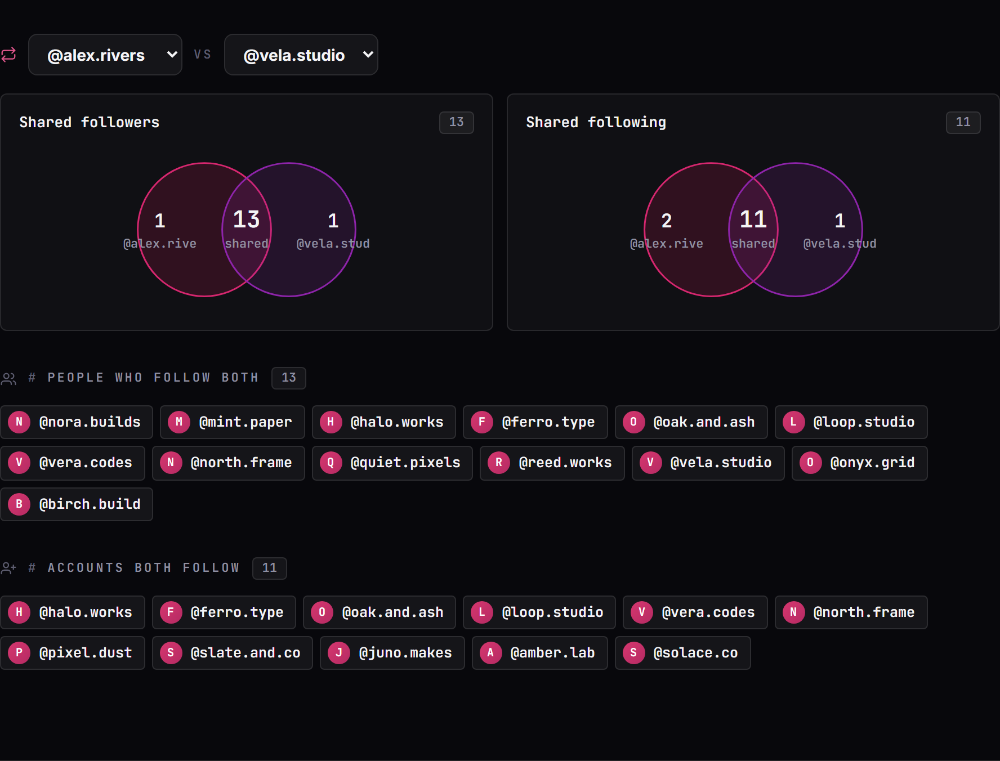

### Light theme

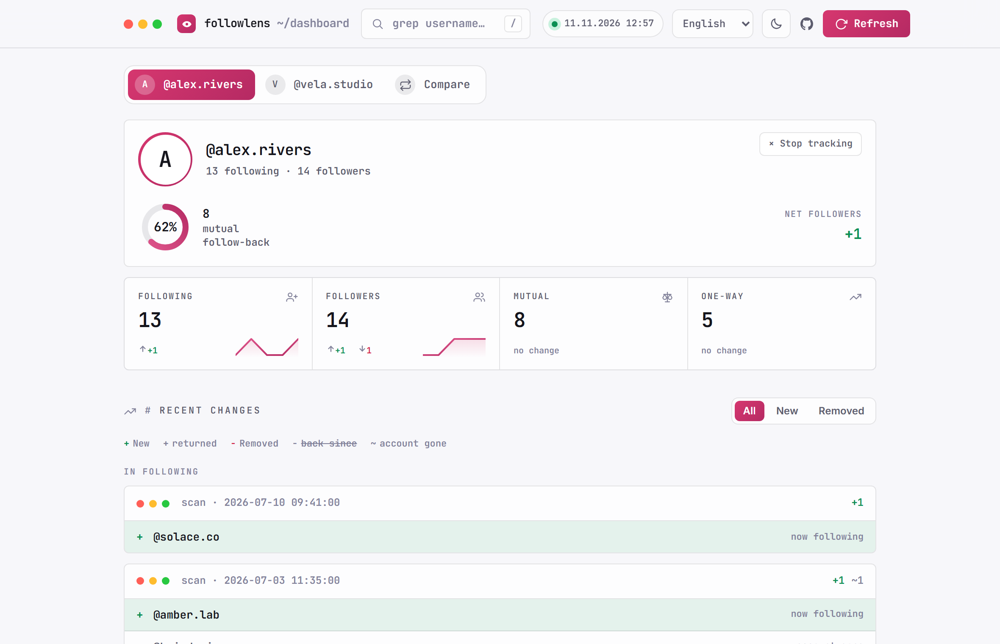

### Narrow screens

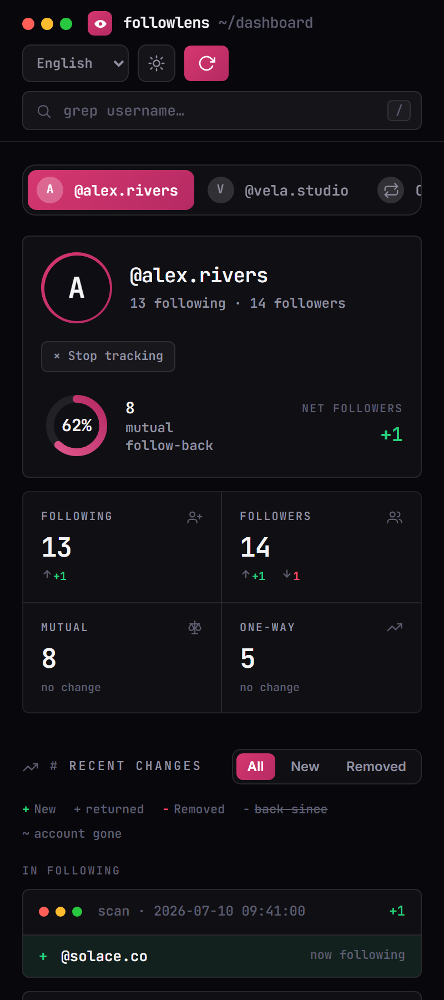

### Landing page

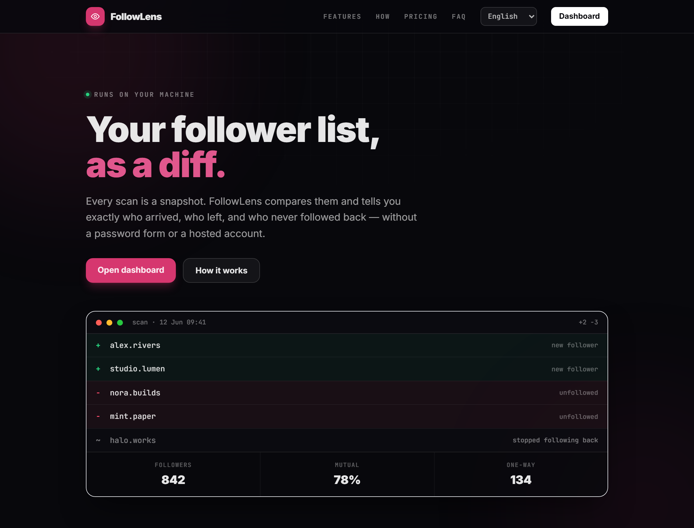

## Languages

FollowLens is fully translated into eight languages. Every label, button, row note, empty state and error message on both pages follows the selected language.

| Code | Language | | Code | Language |
| --- | --- | --- | --- | --- |
| `en` | English | | `de` | Deutsch |
| `tr` | Türkçe | | `fr` | Français |
| `zh` | 中文 (简体) | | `ru` | Русский |
| `es` | Español | | `ja` | 日本語 |

- **Picking a language.** Use the selector in the header. The choice is stored in the browser and shared between the landing page and the dashboard, so whichever page you set it on, the other opens in the same language.
- **First visit.** If nothing has been chosen yet, the browser's own language is used when it is one of the eight; otherwise English.
- **Typography.** Chinese and Japanese labels drop the wide letter-spacing the Latin labels use, so characters are not pulled apart.
- **Without the server.** The landing page keeps its English in the markup and only swaps it once the translation table loads, so it never renders blank.

<table>
<tr>
<td width="33%">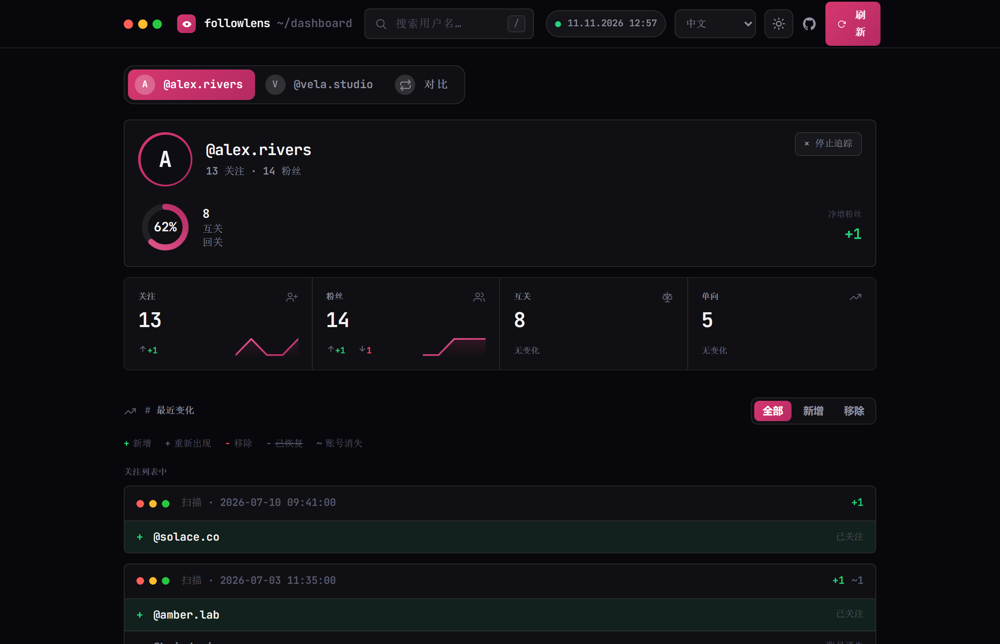</td>
<td width="33%">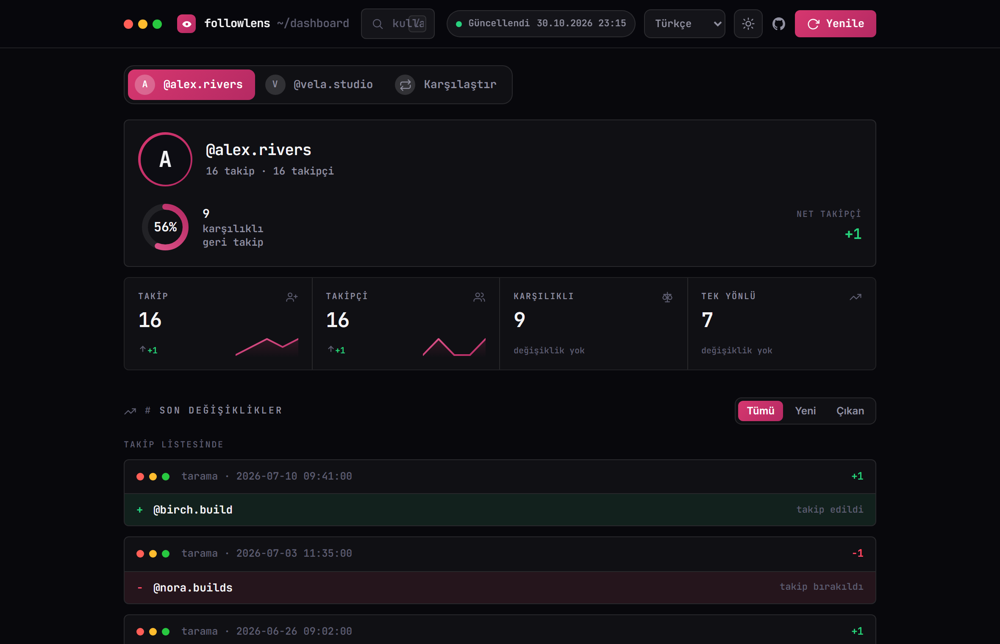</td>
<td width="33%">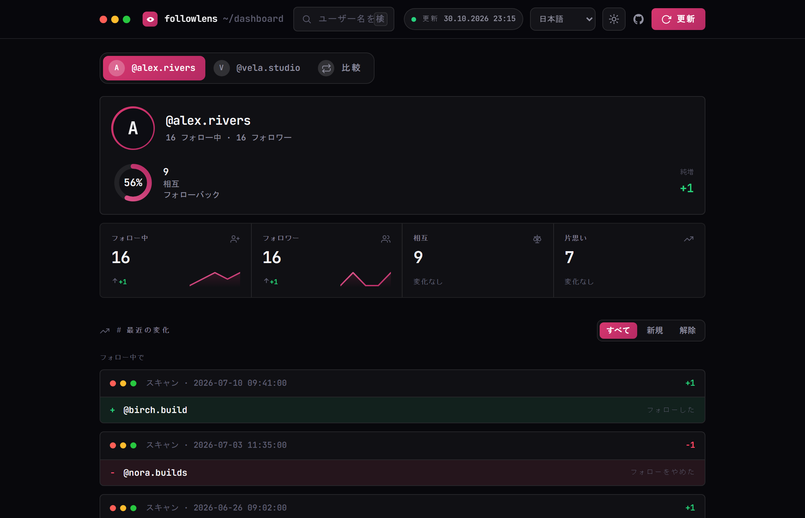</td>
</tr>
<tr>
<td align="center">中文</td>
<td align="center">Türkçe</td>
<td align="center">日本語</td>
</tr>
</table>

### Adding a language

All copy lives in [`backend/i18n.py`](backend/i18n.py): one table for the dashboard and one for the landing page.

1. Add a `(code, native name)` pair to `LANGS`.
2. Add a list of strings for that code to `T` and to `LANDING`, in the same order as `KEYS` and `LANDING_KEYS`.
3. Keep the placeholders: `{n}` is an account name, `{code}` is where the page places its inline `<code>` element, so word order is free to change around it.
4. Run the tests. They fail if a language is missing a key, leaves a string empty, drops a placeholder, or if the landing page and its table disagree about which keys exist.

```bash
.venv\Scripts\python.exe -m unittest discover -s tests
```

## How it works

1. **Add a session.** Paste your `instagram.com` session cookie into `config.json`. No password is entered at any point.
2. **Run a scan.** FollowLens reads the follower and following lists for the selected accounts through Instagram's web endpoints, spacing requests and honouring a cooldown.
3. **Read the diff.** Each run is compared with the previous snapshot to surface exactly what changed.

Instagram does not expose *when* a follow happened, so "recent" always means *since your last scan*. The first scan establishes a baseline; later scans show movement against it.

### Reading the feed

Instagram's list endpoints are not stable. A single pass regularly ends while accounts are still missing, and the next pass hands them straight back, so a naive diff reports a wave of unfollows that never happened, followed by a wave of "new" followers who were there all along. FollowLens collects each list over several passes and then sorts every row into one of five kinds:

| Row | Meaning |
| --- | --- |
| `+ name` &nbsp;&nbsp;*new follower* | Not in any earlier snapshot. Someone genuinely new. |
| `+ name` muted &nbsp;&nbsp;*returned* | An earlier scan showed this account leaving; it is back. Not new. |
| `- name` &nbsp;&nbsp;*unfollowed* | Gone from one list and still gone. A real loss. |
| `- name` struck through &nbsp;&nbsp;*back since* | A later scan returned the account, so the removal did not hold. |
| `~ name` &nbsp;&nbsp;*account gone* | Left the followers and the following list in the same scan: a deactivated, renamed or newly private account rather than an unfollow. |

Only the plain green and plain red rows are real activity. On a real history the muted kinds outnumber them on both sides, which is the whole reason they are drawn differently.

## Installation

```bash
git clone https://github.com/noutrexx/follow-lens.git
cd follow-lens
```

```bash
python -m venv .venv
```

```bash
.venv\Scripts\python.exe -m pip install -r requirements.txt
```

On macOS or Linux, activate the environment first with `source .venv/bin/activate`, then `pip install -r requirements.txt`.

```bash
cp config.example.json config.json
```

### Get your session cookie

1. Open **instagram.com** in a browser where you are already signed in.
2. Open DevTools (`F12`) → **Application** → **Cookies** → `https://www.instagram.com`.
3. Copy the **value** of the `sessionid` cookie.
4. Paste it into the `sessionid` field of `config.json`.

The session cookie grants access to your account. Treat it like a password: keep it in `config.json`, which is git-ignored, and never commit or share it.

### Run

```bash
.venv\Scripts\python.exe run.py
```

Open **http://localhost:5005** and click **Refresh**, or trigger a scan directly:

```bash
curl -X POST http://localhost:5005/scan
```

To skip the cooldown:

```bash
curl -X POST "http://localhost:5005/scan?force=1"
```

### Tracking another account

Type the username into the search box. When it is a valid name that is not tracked yet, a line under the box offers it: press **Enter**. FollowLens adds it to `targets` in `config.json` and reads only that account, so the others are not scanned again.

The first read of a newly added account goes through even if a scan ran minutes ago; after that it follows the cooldown like every other account.

If the account is private and the session does not follow it, FollowLens says so instead of saving an empty list. More generally, a list that comes back empty while the profile, or the previous scan, says it has people in it is never saved, because Instagram returns an empty list rather than an error for accounts it will not show.

**Stop tracking** sits in each account's profile tile. It asks first, then takes the account out of future scans. Its tab stays, muted, because its history is kept in `data/`; the tab offers **Track again**.

## Configuration

`config.json` is copied from `config.example.json` and is git-ignored.

| Key | Description |
| --- | --- |
| `username` | Your own Instagram username, used for the `self` target. |
| `sessionid` | Your `sessionid` cookie value. Stays local. |
| `targets` | Accounts to track. `"self"` is your account; add any usernames your session can already see, here or from the search box. |
| `known_ids` | Optional `username` → `id` map that skips the rate-limited profile lookup. |
| `delay_seconds`, `delay_jitter_seconds` | Randomised delay between requests. |
| `min_scan_interval_seconds` | Cooldown between full scans. Default 600. |
| `followers_max_passes` | Maximum union passes per friendship list. Both lists stop early once a pass adds nothing new, so a settled list costs one extra pass. Raise it if scans keep reporting the same accounts as leaving and returning. |

## Troubleshooting

Every failure is reported per account, in the toast after **Refresh** or in the JSON from `/scan`. The wording tells you which problem you have.

| Message contains | What it means | What to do |
| --- | --- | --- |
| *No account could be read, so the sessionid has most likely expired* | Instagram refused every account in the run. | Copy a fresh `sessionid` into `config.json`. No restart is needed; the next scan reads it. |
| *The session itself works … Instagram is refusing this account for now* | Another account was read in the same run, so the cookie is fine. Instagram is limiting this one account. | Do not fetch a new cookie. Wait a few hours, then retry. |
| *429 … too many scans today* | Instagram is rate-limiting the session as a whole. | Stop for about half an hour. Retrying sooner makes it worse. |
| *… page … was refused: Please wait a few minutes* | Instagram rate-limited the session quietly, with a normal-looking response instead of a 429. The scan stopped before saving anything. | Treat it like a 429: wait, then retry. |
| *… page … was not JSON* | Instagram served a login page instead of data, which means it no longer accepts the session. | Copy a fresh `sessionid` into `config.json`. |
| *Cooldown active: try again in …* | Less than `min_scan_interval_seconds` has passed since the last scan that read something. | Wait it out. `?force=1` skips it, but spends requests you may need later. |
| *config.json not found* / *not valid JSON at line …* | The config is missing or has a syntax error. | Copy `config.example.json`, or fix the reported line and column. |
| *No Instagram account is called @…* | A name in `targets` is misspelled or the account no longer exists. | Stop tracking it from its tab, or correct it in `config.json`. |
| *… is private and this session does not follow it* | Instagram does not show this account's lists to you. | Follow it from the account the session belongs to, or stop tracking it. |
| *… came back empty although the profile shows …* | Instagram hid the list for this read. Nothing was saved. | Try again later; if it persists the account has likely gone private. |
| *Could not reach Instagram* / *did not answer within 30 seconds* | The computer running FollowLens has no connection to Instagram, or it timed out. | Check the internet connection, then scan again. Nothing was saved. |
| *Cannot reach the server* | The page is open but `run.py` is not running. | Start it again. |
| *Scans can only be started from this dashboard* | A request came from another site, or a tool sent a foreign `Origin`. | Use the Refresh button or plain `curl -X POST`. |

A failed run never starts the cooldown, so after fixing the cause you can scan again straight away.

If the same accounts keep leaving and coming back between scans, that is the list endpoints being unstable rather than real activity; see [Reading the feed](#reading-the-feed). Raising `followers_max_passes` reduces it at the cost of a few more requests.

## Privacy and safety

> **Read the [usage guide](docs/USAGE.md) before scanning regularly** ([Türkçe](docs/KULLANIM.md)). It covers how many requests a scan sends, how they are paced, what Instagram may do in response, and what to do when it does.

- **Local only.** Snapshots and your session cookie live in `data/` and `config.json`, both git-ignored. Nothing is uploaded.
- **No password.** Authentication uses a session cookie you copy yourself.
- **Conservative scanning.** Randomised delays, a scan cooldown and backoff on rate limits keep request volume low.
- **Fails loudly.** If a page of a list cannot be fetched, the scan aborts for that account rather than storing a partial list that would read as a wave of unfollows.

> **Disclaimer.** This project is intended for personal and educational use. Automating access to Instagram may violate its Terms of Service and can lead to rate-limiting or account restrictions. You can only read accounts your own session can already access. Use responsibly and at your own risk.

## Tech stack

Python, Flask and requests on the backend. The frontend is plain HTML and JavaScript styled with Tailwind loaded from a CDN — no bundler, no `node_modules`, no build step. Translations are plain Python data embedded as JSON, with no i18n library. Tests run on `unittest`; CI covers Python 3.10–3.12, linting, CodeQL and secret scanning.

## Project structure

```
follow-lens/
├─ run.py                 # entry point: python run.py
├─ backend/
│  ├─ server.py           #   Flask server: routes and the /scan endpoint
│  ├─ scanner.py          #   scan orchestration: cooldown, diff, snapshots
│  ├─ igweb.py            #   Instagram web client, session-based and rate-limit aware
│  ├─ storage.py          #   snapshot storage and diffing
│  ├─ i18n.py             #   every UI string, in eight languages
│  └─ report_html.py      #   dashboard generator
├─ frontend/
│  ├─ landing.html        #   landing page
│  └─ og.svg              #   social preview image
├─ docs/                  # usage guide: request volume, pacing and account risk
├─ tests/                 # unit tests for diffing, pagination, sessions and translations
├─ assets/                # images used in this README
├─ config.example.json    # sample config, copy to config.json
└─ requirements.txt
```

## License

Released under the [MIT License](LICENSE). © noutrexx
